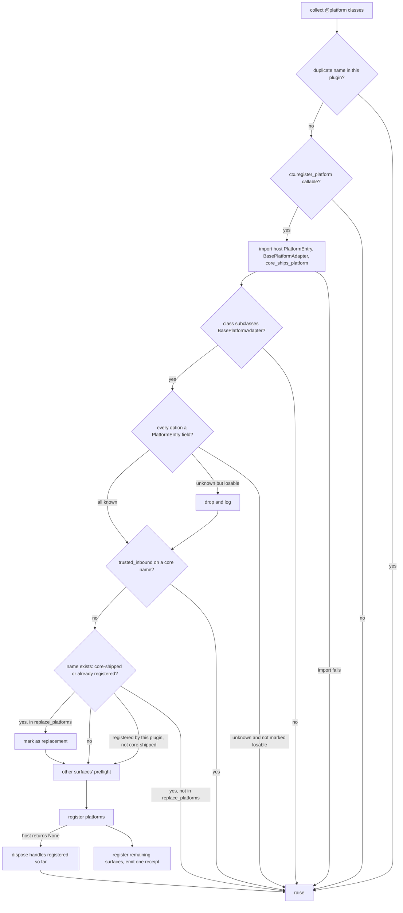

# Platform Annotation - Plan

## Goal Capsule

- **Objective:** A Hermes plugin author can add a messaging platform with the same guarantees the kit already gives tools and hooks: a bad declaration fails before anything registers, an existing platform is never replaced unless the operator allowed it, the registration receipt names the platform, and the drift replay notices when Hermes changes the platform contract.
- **Means:** An `@platform(...)` annotation on the adapter class, discovered and registered by `register_plugin` (KTD1, KTD2).
- **Authority:** This plan's Requirements govern behavior; the deployed Hermes pin (`bf0203a`, `DEPLOYED_HERMES_REVISION` in `hermes_plugin_kit/testing.py`) governs every host fact; repo `AGENTS.md` governs conventions.
- **Base:** `origin/main` at `ca9e1c9`. Local `main` was four merges behind when this plan was written; branch from `origin/main`.
- **Execution profile:** One PR, opened as a draft at the first commit, flipped to ready when the Definition of Done holds.
- **Stop conditions:** Stop and ask if `DEPLOYED_HERMES_REVISION` in `hermes_plugin_kit/testing.py` no longer reads `bf0203a794a07aac3ff764972ab9087baa4e4f4e` and, at the new pin, `register_platform`, `PlatformEntry`, `PlatformRegistry.is_registered`, `PlatformRegistry.snapshot_registration`, `PlatformRegistry.current_scope_key`, `core_ships_platform` or `BasePlatformAdapter` changed shape.
- **Who finishes:** The implementing agent ships through to an open PR; merging needs the owner.

---

## Product Contract

### Summary

Add an `@platform(...)` annotation that marks a `BasePlatformAdapter` subclass as a gateway platform, and make `register_plugin` validate and register it through `ctx.register_platform`. Replacing a platform that already exists fails loudly unless the operator names it in the plugin's config. The receipt, the recording test host, the drift replay, the README and the authoring skill all learn about platforms.

### Problem Frame

The kit registers commands, tools, middleware, hooks, skills, providers and a context engine, but not platforms. A plugin that adds a messaging channel has to call `ctx.register_platform` directly, outside the kit, which is what the planned private Daphne web channel in the Nightingale plugin was about to do.

That direct call gets none of the kit's guarantees, and platforms need them more than tools do:

- **The option surface churns.** `PlatformEntry` had 26 fields at `f80f453` (2026-08-14) and 46 at the pin (2026-10-22). An older host rejects an unknown option with a `TypeError` raised mid-registration, after other surfaces may already be registered.
- **Some options decide who may talk to the agent.** `trusted_inbound`, `allowed_users_env`, `allowlist_suppresses_pairing` and `group_allowed_chats_env` are access policy, not display.
- **Replacement is silent.** The platform registry is last-writer-wins; a plugin that registers `telegram` replaces the real adapter and Hermes logs it at INFO (`PlatformRegistry.register` in `gateway/platform_registry.py`).
- **Refusal is silent.** `PluginContext.register_platform` returns `None` when its registration did not take, and nothing checks it.
- **Drift is invisible.** `register_platform` takes `**entry_kwargs`, so replaying a recorded call against its signature accepts any option name; a removed or renamed field would report clean.

### Requirements

**Declaring a platform**

- R1. A plugin declares a platform by annotating its adapter class with `@platform(...)`, giving at least a name, a label and a passive dependency check.
- R2. A platform name must already be in the form Hermes keys on: non-empty, stripped and lowercase. Anything else fails at decoration time.
- R3. Every other `PlatformEntry` option the host supports can be passed through the annotation without the kit hard-coding it (KTD2).
- R4. Annotating does not import Hermes.

**Registering it**

- R5. `register_plugin` discovers annotated adapters alongside the other declarations, rejects two declarations that share a platform name, and registers each platform through `ctx.register_platform`.
- R6. Every platform check finishes before the first `ctx.register_*` call, so a bad platform declaration registers nothing at all.
- R7. An option name the host's `PlatformEntry` does not have fails the registration, unless the plugin marked that option as one it accepts losing; a dropped option is logged by name.
- R8. The annotated class must subclass the host's `BasePlatformAdapter`; checked at `register_plugin` time.
- R9. `trusted_inbound` is never set unless the plugin sets it explicitly, and setting it on a platform Hermes ships fails in preflight rather than mid-registration.
- R10. When Hermes returns `None` from `register_platform`, `register_plugin` raises naming the platform instead of reporting success.

**Replacing an existing platform**

- R11. Registering a platform whose name already exists fails loudly before anything registers. "Exists" means Hermes ships it, or it is already registered when this plugin registers.
- R12. The only override is an explicit list of platform names in the plugin's own `plugins.<name>` config. The failure message names the platform, its current owner where known, and the exact config key to set.

**Receipt and drift**

- R13. The registration receipt names each registered platform and each platform it replaced under an override.
- R14. The recording test host records `register_platform` calls, and the drift replay reports an option the host's `PlatformEntry` no longer has.

**Docs**

- R15. The README, the authoring skill reference and repo `AGENTS.md` describe the annotation, the replacement override, and the "accepts losing" marker.

### Key Decisions

- **Replacing an existing platform requires an operator config flag, not a code flag.** (session-settled: user-directed — chosen over a decorator argument the plugin author sets: the person running the profile decides whether a built-in channel is swapped out.) Governs R11, R12.

### Scope Boundaries

- Writing any platform adapter, including the Daphne web channel.
- Base-adapter helpers (connection, typing, media) — `BasePlatformAdapter` and Hermes's public helpers already own these.
- `register_platform_handler` / `register_telegram_handler`, which add handlers to platforms that already exist. A separate surface; Nightingale's `getattr(ctx, "register_telegram_handler", None)` path is untouched.
- Considered and not built: **decorating a factory function instead of a class.** Hermes's examples and every bundled plugin pass the class or a one-line lambda over it; a plugin that needs constructor arguments can subclass. Revisit if a consumer needs a factory the class cannot express.
- Considered and not built: **guarding against a plugin that loads after this one and takes the name.** The kit only sees its own registration; Hermes's last-writer-wins applies there. Revisit if Hermes exposes a registration hook the kit can observe.
- Considered and not built: **a kit-owned baseline of `PlatformEntry` field names.** It would go stale at the observed rate of change; the host's own dataclass is the source (KTD2).

### Sources

- Host API at the pin: `PluginContext.register_platform` (`hermes_cli/plugins.py`), `PlatformEntry`, `PlatformRegistry.register`, `core_ships_platform` (`gateway/platform_registry.py`), `Platform._missing_` (`gateway/config.py`), `BasePlatformAdapter` (`gateway/platforms/base.py`).
- Guide at the pin: `website/docs/developer-guide/adding-platform-adapters.md` (feature-detect pattern via `dataclasses.fields(PlatformEntry)`, `trusted_inbound` warning) and `gateway/platforms/ADDING_A_PLATFORM.md`.
- Loading: `gate_manifest` (`hermes_cli/plugins_discovery.py`) defers only bundled `kind: platform` plugins; a user plugin with tools and a platform loads eagerly when enabled.
- Reference consumer at the pin: `plugins/platforms/irc/adapter.py` `register`.
- Kit memory: `record-and-bind-beats-strict-fakes` (why option names need their own replay check).

---

## Planning Contract

### Key Technical Decisions

- KTD1. **The annotation marks the class and does not wrap it.** `@platform` sets a spec attribute on the class (alongside `_hpk_tool_spec` and friends) and returns the class unchanged, so `isinstance`, subclassing and Hermes's own construction behave as written. The class itself is the `adapter_factory`, because Hermes calls `adapter_factory(PlatformConfig)` and the documented adapter shape is `__init__(self, config)`.
- KTD2. **Options pass through and are checked against the host's own `PlatformEntry`.** `register_plugin` reads `dataclasses.fields(PlatformEntry)` from the host during preflight, importing it lazily the way the context-engine path imports `ContextEngine`. Unknown names fail (R7); names the plugin marked as acceptable to lose are dropped and logged. The kit refuses host-owned keys (`source`, `plugin_name`) and keys that duplicate the annotation's named arguments. Chosen over typed keyword arguments for all 46 fields, which would trail Hermes by weeks.
- KTD3. **Existence is read without materializing deferred loaders.** `PlatformRegistry.get` runs a bundled platform's deferred loader and imports its SDK, so preflight never calls it. Instead it uses `core_ships_platform(name)` (Hermes ships it, answered from manifests) or `platform_registry.is_registered(name)` (public, and documented at the pin to count a deferred loader as registered without importing it). Both are needed: `core_ships_platform` also covers static `Platform` enum members that need not sit in the registry. The owner comes from `snapshot_registration(name, scope=PlatformRegistry.current_scope_key())`, which reads concrete and deferred state without resolving either; `PlatformEntry.plugin_name` names it. An existing entry whose `plugin_name` equals this plugin's host manifest name (`ctx.manifest.name`, the value `register_platform` writes into `plugin_name` at the pin, not the receipt identity) is a re-registration, not a replacement, but only for a name `core_ships_platform` answers false: a core-shipped name always needs the override, whoever registered it last. On a host missing any of these, preflight fails closed rather than skipping the guard. `core_ships_platform`, `PlatformRegistry.is_registered`, `PlatformRegistry.snapshot_registration` and `PlatformRegistry.current_scope_key` were read at the pin on 2026-11-13, alongside `PluginContext.register_platform`, `PlatformEntry` and `BasePlatformAdapter`; U5 binds all seven.
- KTD4. **The override lives at `plugins.<plugin>.replace_platforms`, read through `load_plugin_config`.** A list of platform names. A name on the list that does not currently exist is allowed and changes nothing. (session-settled: user-directed — chosen over a decorator argument: the operator decides.) Instantiates the Key Decision; Governs R11, R12.
- KTD5. **Platforms register first among the mutations, and a refusal rolls back the platforms already registered.** Their refusal (R10) is the most likely late failure, so registering them before the context engine, commands and tools keeps a refusal from leaving those half-registered. Preflight (R6) still catches every known failure before any mutation. A refusal can only appear after a `register_platform` call, so to keep R6's "registers nothing" when a later platform in the same plugin is refused, the kit keeps each returned handle and, on a `None` return, calls `dispose()` on the handles from this call in reverse order before raising. At the pin, `PluginRegistration.dispose` (`hermes_cli/plugins_ledger.py`) releases the scoped lease, which restores the entry an override replaced and is identity-conditional, so it never removes a newer registration.
- KTD6. **The receipt gains `platforms` and `replaced_platforms`, appended after the existing fields.** `log_registration_summary` keeps its current field order and appends the two new fields at the end, so log parsers keyed on position still read the old fields correctly. `RegistrationSummary` gains matching tuple fields defaulting to empty.
- KTD7. **The drift replay checks option names in addition to the signature.** Signature binding cannot see names inside `**entry_kwargs`, so for `register_platform` the replay also compares each recorded option name with the host checkout's `PlatformEntry` fields and reports missing ones as drift. This extends the existing `plugin-test-harness` OpenSpec requirement "Recorded calls replay against the real host signatures" with a new scenario.

### High-Level Technical Design

Preflight order inside `register_plugin` for platforms. Every node before "register platforms" is a pure check; a failure there raises with nothing registered. A host refusal can only surface at "register platforms" itself, so that edge disposes the platform handles this call already holds before raising (KTD5); no other surface has registered yet.

### Implementation Constraints

- Keep `@tool`, `@command`, `register_all` and the existing `register_plugin` signature backward compatible; `register_plugin` gains no required argument.
- `register_plugin` emits exactly one receipt through `log_registration_summary`.
- No module-level Hermes import in `hermes_plugin_kit/__init__.py` (offendingcommit/hermes-plugin-kit#49 removed the last one).
- Redact secret-looking values: never log option values, only option names.

---

## Implementation Units

### U1. `@platform` annotation and decoration-time validation

**Goal:** A class can be annotated as a platform, and malformed annotations fail at import time.

**Requirements:** R1, R2, R3, R4, R9

**Dependencies:** none

**Files:**
- `hermes_plugin_kit/__init__.py` — the `platform` decorator, its spec attribute, export in `__all__`.
- `tests/test_platforms.py` (new) — decoration-time behavior. This seam catches bad declarations without any host; it cannot see host fields or registry state.

**Approach:**
- Named arguments for the always-present fields (name, label, check function, and the optional validate function, required env, install hint), plus a free mapping of further options and a set of option names the plugin accepts losing (KTD2).
- Validate at decoration time only what needs no host: name form (R2), non-empty label, callable check and validate functions, option names are identifiers, the losable set is a subset of the passed options, the target is a class, and `trusted_inbound` is not defaulted on (R9).
- Mark, do not wrap (KTD1). Read the spec back with `vars(cls).get(...)`, never `getattr`: a class attribute is inherited, so `getattr` would make an unannotated subclass of an annotated adapter look like a second declaration of the same platform.

**Patterns to follow:** `hook` and `middleware` decorators in `hermes_plugin_kit/__init__.py` (spec attribute plus `ValueError` on bad input); `plugin_skill` for a declaration with a validated optional set.

**Test scenarios:**
- Annotating a class with name `web_chat`, label `Web Chat` and a check function returns the same class object, carrying a spec with those values.
- Name `Web_Chat`, ` web_chat `, or an empty string each raises `ValueError` naming the rule.
- A non-callable check function raises `TypeError`.
- Annotating a function instead of a class raises `TypeError`.
- A losable option that was not passed as an option raises `ValueError` naming it.
- Passing `source` or `plugin_name` as an option raises `ValueError` saying the host owns it.
- Importing a module that uses `@platform` with Hermes absent from `sys.modules` and from the path succeeds (R4).

**Verification:** The new tests pass and the annotation is reachable as `hermes_plugin_kit.platform` from a built wheel (the existing public-surface check covers this once `__all__` lists it).

### U2. Discovery, preflight and registration in `register_plugin`

**Goal:** `register_plugin` registers annotated platforms with every check done before any mutation, and reports them in the receipt.

**Requirements:** R5, R6, R7, R8, R9, R10, R13

**Dependencies:** U1

**Files:**
- `hermes_plugin_kit/__init__.py` — discovery in `register_plugin`, platform preflight, registration, `RegistrationSummary` fields, `log_registration_summary` fields (KTD6).
- `hermes_plugin_kit/testing.py` — the receipt assertion helper that pins field order, if it enumerates fields.
- `tests/test_platforms.py` — registration behavior against the recording host plus a stand-in for the host's platform module.

**Approach:**
- Collect platform specs in the same declaration loop as the other surfaces; duplicate names raise (R5).
- Run the platform preflight from the High-Level Technical Design before any other surface's mutation (R6, KTD5).
- Register with keyword arguments only; on a `None` return, dispose the handles of platforms this call already registered, then raise (R10, KTD5).
- Append `platforms` and `replaced_platforms` to the summary and receipt (KTD6).
- Iterable registration (a list of declarations) must accept annotated classes too, not only decorated callables; the current "declaration iterables must contain only decorated callables" check needs to admit a class carrying the platform spec.

**Execution note:** Start with a failing test where a bad option name is declared next to a valid tool, asserting the tool was not registered. That is the ordering guarantee this unit exists for.

**Patterns to follow:** The context-engine block in `register_plugin` (lazy host import, `RuntimeError` when the registrar is missing, preflight before mutation); `_validate_generation_providers`.

**Test scenarios:**
- A module with one tool and one annotated platform registers both; the receipt line ends with `platforms=web_chat; replaced_platforms=<none>`.
- Two annotated classes sharing the name `web_chat` raise `ValueError` naming it, and nothing is registered.
- An option `display_tier="minimal"` against a host `PlatformEntry` without that field raises naming `display_tier`, and the tool declared alongside was not registered.
- The same option marked losable is dropped; registration proceeds and a warning names `display_tier`.
- A class not subclassing the host's `BasePlatformAdapter` raises `TypeError` naming the class.
- `trusted_inbound=True` on name `telegram` raises before any registration.
- A host `register_platform` returning `None` makes `register_plugin` raise naming the platform.
- Two platforms where the host refuses the second: `register_plugin` raises, the first platform's handle was disposed, and no tool or command declared alongside was registered.
- An unannotated subclass of an annotated adapter, defined in the same module, is not discovered as a platform and raises no duplicate-name error.
- A context without `register_platform` raises `RuntimeError` when a platform is declared, and is fine when none is.
- Passing an iterable that holds an annotated class registers it.
- A module with no platforms produces a receipt with `platforms=<none>` and every pre-existing field in its old position.

**Verification:** New tests pass; every existing `register_plugin` and receipt test still passes unchanged except for the appended fields.

### U3. Replacement guard and the `replace_platforms` override

**Goal:** Registering over an existing platform fails loudly unless the operator listed it.

**Requirements:** R11, R12, R13

**Dependencies:** U2

**Files:**
- `hermes_plugin_kit/__init__.py` — existence check and override read inside the platform preflight.
- `tests/test_platforms.py` — guard behavior.

**Approach:**
- "Exists" per KTD3: `core_ships_platform(name)` or `platform_registry.is_registered(name)`; owner from `snapshot_registration` in the current scope. Never `get`. The own-plugin reload exemption compares `plugin_name` with `ctx.manifest.name` and applies only to names `core_ships_platform` answers false.
- Read `replace_platforms` through `load_plugin_config` (KTD4). A non-list value fails preflight with the key named.
- The error names the platform, the current owner when the registry exposes it (`source`, `plugin_name`), and the exact key `plugins.<plugin>.replace_platforms`.
- A permitted replacement lands in `replaced_platforms` on the receipt.

**Test scenarios:**
- Declaring `telegram` with no override raises; the message contains `telegram` and `plugins.<plugin>.replace_platforms`, and nothing registered.
- Declaring `telegram` with `replace_platforms: [telegram]` registers it and the receipt shows `replaced_platforms=telegram`.
- Declaring `web_chat` while another plugin's `web_chat` is already registered raises naming that plugin as owner, and nothing is registered.
- Declaring a bundled platform's name while it is still only a deferred loader raises, nothing is registered, and the bundled module is absent from `sys.modules`.
- The same deferred name with `replace_platforms` naming it registers, the receipt lists it under `replaced_platforms`, and the bundled module is still absent from `sys.modules`.
- An existing entry whose `plugin_name` is this plugin's own name (a reload) registers without an override and is not listed under `replaced_platforms`.
- An existing `telegram` entry whose `plugin_name` is this plugin's own name still raises without `replace_platforms`: the reload exemption never covers a core-shipped name.
- Declaring a new name `web_chat` with `replace_platforms: [telegram]` registers normally and the receipt shows `replaced_platforms=<none>`.
- `replace_platforms: telegram` (a string, not a list) raises naming the key.
- A host missing any of `core_ships_platform`, `is_registered`, `snapshot_registration` or `current_scope_key` makes preflight raise once, listing every missing name, rather than skip the guard. One parametrized test, driven from the same tuple of names preflight checks, covers each single absence plus all four absent, and asserts the message names every absent symbol (set membership, not exact text).
- In every raising case above, the recording host shows no registration of any kind, including a tool declared in the same plugin: the guard runs in preflight (R6), not inside platform registration.

`gate_manifest` at the pin defers only manifests whose `source` is `bundled`, so a user plugin never meets its own name as a deferred loader; a deferred hit is always another owner.

**Verification:** New tests pass, and the U4 real-host lane shows the guard refusing a core name against the pinned Hermes.

### U4. Recording host and option-name drift replay

**Goal:** Plugin tests can record platform registrations, and the drift replay reports a removed or renamed platform option.

**Requirements:** R14

**Dependencies:** U2

**Files:**
- `hermes_plugin_kit/testing.py` — `register_platform` on `RecordingPluginContext` (returning a handle with `dispose()`, so KTD5's rollback runs against the recording host), `register_platform` in `_ALL_REGISTRARS`, the option-name check in the replay (KTD7), and the `check_against_host` / `DriftReport` shape change below.
- `openspec/changes/<new-change>/` — a spec delta adding "Host removes a platform option" to the `plugin-test-harness` requirement "Recorded calls replay against the real host signatures".
- `tests/test_testing_harness.py`, `tests/test_drift_classification.py` — replay behavior.

**Approach:**
- Record keyword calls like the other keyword-only registrars; no `_POSITIONAL_PARAMS` entry is needed.
- In the replay, after signature binding, read `PlatformEntry` field names from the host checkout and diff them against each recorded option name. `check_against_host(host)` takes only the `PluginContext` class today, so it gains an optional keyword carrying the `PlatformEntry` field names, which `ResolvedHost` fills from the checkout. Existing callers that pass only the class keep working.
- `DriftReport.checked` is one boolean for the whole report, so it cannot say "signatures checked, platform options not". Give the report a per-surface unchecked record (for example a tuple of unchecked surface names with reasons) and keep `checked` meaning "every surface was checked".
- A host checkout without `gateway/platform_registry.py`, or a call that passes no field names while a `register_platform` call was recorded, reports the platform-option surface as not checked, never clean (spec requirement "Absent host is reported, never assumed clean").

**Test scenarios:**
- A plugin registering `web_chat` through `RecordingPluginContext` shows one recorded `register_platform` call with its options.
- Replaying that call against a host whose `PlatformEntry` lacks `display_tier` reports drift naming `register_platform` and `display_tier`.
- Replaying against a host that has every recorded option reports clean.
- Replaying against a host checkout with no platform registry module reports the surface as not checked.
- Every existing replay scenario (added parameter, renamed keyword, renamed positional, removed registrar, unchanged host) still passes.

**Verification:** Harness tests pass; `openspec validate` (through `just spec-validate`) accepts the change.

### U5. Real-host contract test at the pin

**Goal:** Prove the annotation registers against the real pinned Hermes, not only the recording host.

**Requirements:** R5, R8, R10, R11

**Dependencies:** U3

**Files:**
- `tests/test_hermes_contract.py` — platform cases using the real `PluginContext` and `platform_registry`.

**Approach:**
- Reuse the module's existing real-host setup; build a minimal `BasePlatformAdapter` subclass inside the test.
- Unregister what the test registers so the shared registry stays clean for other cases.

**Patterns to follow:** The existing context-engine and skill cases in `tests/test_hermes_contract.py`.

**Test scenarios:**
- Registering `hpk_contract_platform` through `register_plugin` leaves a `PlatformEntry` in the real registry with the declared label, check function and options.
- Declaring `telegram` without an override is refused before the real registry changes.
- Declaring an option the pinned `PlatformEntry` lacks is refused before the real registry changes.
- Rollback against the real registry: register a fresh platform and an overriding `telegram` (with `replace_platforms`), force the host to refuse a third (wrap the real `platform_registry.register` so it skips storing that one entry; at the pin `register_platform` then sees `snapshot_registration` disagree and returns `None`, which is the host's own refusal path, not an option error; the test also asserts the wrapper ran, so it cannot pass if the host stops calling through the instance), and assert that the fresh name is gone and the original `telegram` entry is back, compared with `snapshot_registration` taken before the call.
- Every host symbol the preflight depends on accepts the call the kit makes, checked by binding the kit's own call shape with `inspect.signature`, not by `hasattr`: `PluginContext.register_platform`, the `PlatformEntry` dataclass, `PlatformRegistry.is_registered`, `PlatformRegistry.snapshot_registration`, the static `PlatformRegistry.current_scope_key`, the module function `core_ships_platform` in `gateway/platform_registry.py`, `BasePlatformAdapter` in `gateway/platforms/base.py` (importable, and the minimal test adapter subclasses it), and `PluginRegistration.dispose` on the handle `register_platform` returns. A pin bump that breaks any of them fails this case, so the Goal Capsule stop condition never depends on someone remembering it. Falsify once by renaming a parameter in a scratch checkout.

**Verification:** `just test-contract-pinned` runs these cases against `bf0203a` and reports them as run, not skipped (memory `skipped-is-not-passed-on-py311`: check the count, not the exit code).

### U6. Docs and authoring skill

**Goal:** Plugin authors can find and use the annotation without reading the source.

**Requirements:** R15

**Dependencies:** U3

**Files:**
- `README.md` — a platform section next to "Subagents and specialized providers", and the receipt fields in "Structured plugin lifecycle receipts".
- `skills/hermes-plugins/references/plugin-kit.md` — Surface Map, What The Kit Owns, Failure Traps (replacement, losable options, deferred bundled platforms).
- `AGENTS.md` — one working rule for platform registration.

**Approach:** Show one complete adapter-plus-annotation example, the `replace_platforms` config snippet, and the losable-option marker. Point to Hermes's adapter guide for the adapter itself rather than restating it.

**Test expectation:** none -- documentation; the existing documented-names check in `test_kit.py` covers that `platform` is exported.

**Verification:** Every name the README uses is exported, and the skill reference matches the shipped API.

---

## Open Questions

- **Deferred to implementation:** the exact name of the losable-options argument. Keep it consistent with `skipped_optional_skills`; the summary fields are fixed by KTD6.

---

## Verification Contract

| Gate | Command | Proves |
|---|---|---|
| Unit and harness tests | `just test` | U1–U4 behavior; check the printed test count went up by the new cases |
| Pinned real host | `just test-contract-pinned` | U5 against `bf0203a`; cases reported as run |
| Spec | `just spec-validate` | U4's OpenSpec change is valid |
| Packaging | `just build`, `just check-dist`, `just check-install` | `platform` is exported from the built wheel |

Capture each command's own exit status (`cmd > log 2>&1; echo "EXIT=$?" >> log`), not one read through a pipe.

---

## Definition of Done

- Every test scenario above exists and passes. Each guard named in R6–R12 has been falsified: removing it makes its own test fail and no other test fail.
- Every existing test case is kept; any case whose expected receipt line changed is adapted in place, not deleted.
- The receipt keeps every pre-existing field in its old position.
- The OpenSpec change is valid and archived with the merge, per the repo's spec-driven rule.
- No abandoned-attempt code remains in the diff.
- The PR is up to date with `origin/main` by merge, every gate in the Verification Contract is green on the final head, and the PR body names the deployed pin it was proven against.
